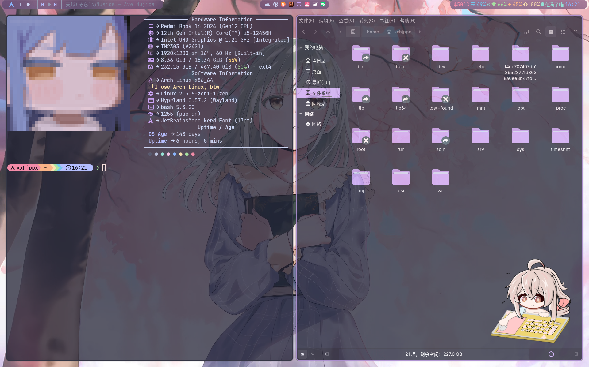
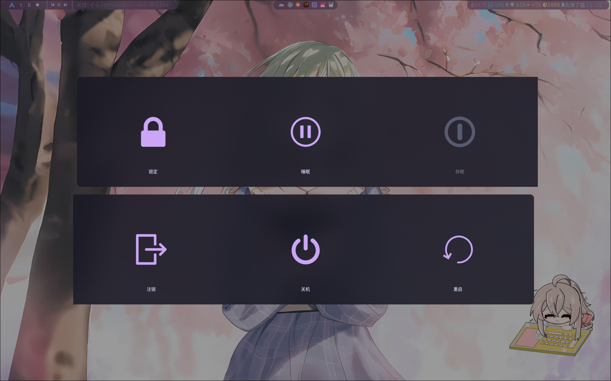

# Sakinux

> A keyboard-driven Hyprland rice, hand-built for personal use

English · [中文](README.md)


[](screenshots/desktop.png)

Built up slowly around my own habits. Nothing but waybar and Hyprland.

My use case: a student watching online lectures, debugging/simulating ROS, running agents, and light gaming.

Most things are keybinds. Aiming for minimal and modern.

Heavy use of vibe coding.

## Preview

| fastfetch + Nemo | wlogout (`Super+Delete`) |
|:---:|:---:|
| [](screenshots/fastfetch.png) | [](screenshots/wlogout.png) |

> [!NOTE]
> Tuned for 1920×1200 and a `BAT0` battery, so you may need to adjust. What to change is listed [here](docs/install.md#已知问题) (in Chinese).

## Install

<details>
    <summary>Automatic</summary>

```bash
git clone https://github.com/ShrimpTale/sakinux-dotfiles ~/dotfiles && cd ~/dotfiles
./install.sh --dry-run
./install.sh
systemctl --user enable --now cliphist
```

Log out and back in afterwards. Add `--with-theme-studio` if you want theme switching.

</details>

<details>
    <summary>Manual</summary>

- Base deps: `hyprland waybar wlogout rofi swaync ghostty starship fastfetch cliphist ttf-jetbrains-mono-nerd`
- Looks: `catppuccin-gtk-theme-mocha`, `catppuccin-cursors-mocha`, `papirus-icon-theme`
- Move files: `config/` → `~/.config/`, `local/` → `~/.local/`, `gtk-themes/` → `~/.themes/`
- Replace `@@HOME@@` in `config/wlogout/style.css`, `config/fastfetch/config.jsonc`, `config/autostart/bongocat.desktop` with your own home directory
- Switch themes with `zhuti` (needs theme-studio, see [theme system](docs/theme-studio.md)); for icons to follow the theme, run `python3 theme-studio/icon-variants.py install`
- `config/fuzzel/` is a leftover from the early fuzzel setup; rofi is used now

</details>

## Keybinds (change them in hyprland.lua)

| Key | Action |
|---|---|
| `Super+Q` / `Super+C` | Terminal / close window |
| `Super+R` | Launcher |
| `Super+E` | File manager |
| `Super+Arrows` | Move focus |
| `Super+1..0` | Switch workspace |
| `Super+Shift+1..0` | Send window to that workspace |
| `Super+V` / `Super+P` / `Super+J` | Toggle floating / pseudo-tile / split direction |
| `Super+S` | Special workspace (scratchpad) |
| `Super+Alt+X` | Region screenshot, saved to disk + copied to clipboard |
| `Super+Alt+V` | Clipboard history |
| `Super+Delete` | wlogout power menu |
| `Super+Alt+letter` | Common apps (Firefox, Steam, VSCode, WeChat…) |
| `XF86*` | Volume, brightness, media |
| `Super+drag` / `right-drag` / `scroll` | Move window / resize / switch workspace |

All 38 binds: [docs/keybinds.md](docs/keybinds.md) (in Chinese).

## More (AI-assisted)

- [Install pitfalls, and which values are machine-specific](docs/install.md)
- [How to switch between the 6 themes, and what each generator does](docs/theme-studio.md)
- [Why it's designed this way, and what it costs](docs/design.md)
- [What's not included (wallpapers, lock screen, rofi themes…) and how to do it yourself](docs/not-included.md)

## Thanks to

- [HyDE](https://github.com/HyDE-Project/HyDE): wlogout's look and feel
- [Catppuccin](https://github.com/catppuccin): colors, GTK theme base, cursors, fcitx5 skin, ghostty palette
- [Papirus](https://github.com/PapirusDevelopmentTeam/papirus-icon-theme) + papirus-folders: icons
- [BongoCat](https://github.com/ayangweb/BongoCat): the desktop pet
- [waywallen](https://github.com/waywallen/waywallen): dynamic wallpaper client
- [Hyprland](https://github.com/hyprwm/Hyprland)

## License (AI-assisted)

MIT, see [LICENSE](LICENSE). What's not included and who it belongs to: [this list](docs/not-included.md)
