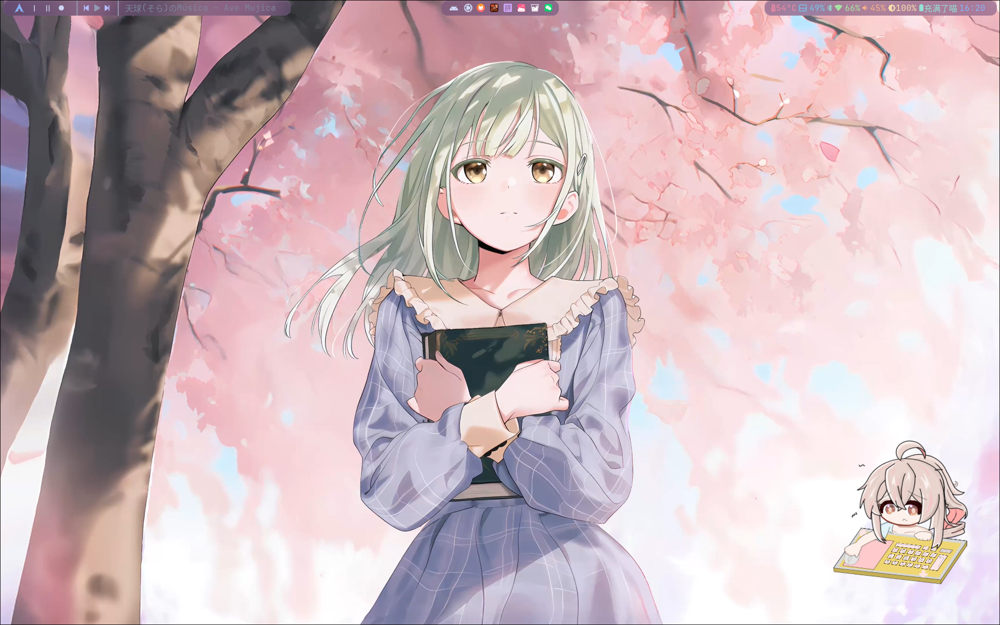

# Sakinux

> 自用手搓的键盘流 Hyprland 桌面美化


[](screenshots/desktop.png)

根据自己使用习惯慢慢手搓的键盘流美化，除了waybar与hyprland别无他物

基于catppuccin配色的毛玻璃灵动岛,轻松豪到9178亿同学

场景基于大学生看网课，ros调试仿真，跑agent干活与轻度娱乐

大部分功能通过绑定快捷键进行，力图做到简约现代

大量使用了vibe coding

## Preview

| fastfetch + Nemo | wlogout（`Super+Delete`） |
|:---:|:---:|
| [](screenshots/fastfetch.png) | [](screenshots/wlogout.png) |

> [!NOTE]
> 基于1920×1200、与`BAT0` 电池，可能需根据设备调整，详见[这里](docs/install.md#已知问题)

## 安装

<details>
    <summary>自动</summary>

```bash
git clone https://github.com/ShrimpTale/sakinux-dotfiles ~/dotfiles && cd ~/dotfiles
./install.sh --dry-run     
./install.sh               
systemctl --user enable --now cliphist
```

装完需重启桌面。想换主题再加个 `--with-theme-studio`

</details>

<details>
    <summary>手动</summary>

- 基础依赖：`hyprland waybar wlogout rofi swaync ghostty starship fastfetch cliphist ttf-jetbrains-mono-nerd`
- 外观：`catppuccin-gtk-theme-mocha`、`catppuccin-cursors-mocha`、`papirus-icon-theme`
- 搬文件：`config/` → `~/.config/`，`local/` → `~/.local/`，`gtk-themes/` → `~/.themes/`
- `config/wlogout/style.css`、`config/fastfetch/config.jsonc`、`config/autostart/bongocat.desktop` 里的 `@@HOME@@` 换成本地～目录
- 换主题用 `zhuti`（需 theme-studio，见[主题系统](docs/theme-studio.md)）；图标同步变色功能需 `python3 theme-studio/icon-variants.py install`
- `config/fuzzel/` 是早期用 fuzzel 的残留，现在走 rofi

</details>

## 键位，可于hyprland.lua更改

| 键 | 动作 |
|---|---|
| `Super+Q` / `Super+C` | 终端 / 关窗 |
| `Super+R` | 启动器 |
| `Super+E` | 文件管理器 |
| `Super+方向键` | 移焦点 |
| `Super+1..0` | 切工作区 |
| `Super+Shift+1..0` | 把窗口丢到那个工作区 |
| `Super+V` / `Super+P` / `Super+J` | 浮动切换 / 伪平铺 / 切分屏方向 |
| `Super+S` | 特殊工作区（暂存器） |
| `Super+Alt+X` | 区域截图，存盘 + 进剪贴板 |
| `Super+Alt+V` | 剪贴板历史 |
| `Super+Delete` | wlogout 关机菜单 |
| `Super+Alt+字母` | 常用程序（Firefox、Steam、VSCode、微信…） |
| `XF86*` | 音量、亮度、播放控制 |
| `Super+拖拽` / `右键拖拽` / `滚轮` | 移动窗口 / 缩放 / 切工作区 |

全部 38 个绑定见 [docs/keybinds.md](docs/keybinds.md)。

## 其他（AI辅助整理）

- [装的时候有哪些坑、哪些值绑机器](docs/install.md)
- [6 套主题怎么切，生成器各干什么](docs/theme-studio.md)
- [为什么这么设计，代价是什么](docs/design.md)
- [没收录的那些（壁纸、锁屏、rofi 主题…）怎么自己搞](docs/not-included.md)

## Thanks to

- [HyDE](https://github.com/HyDE-Project/HyDE)：wlogout视觉效果
- [Catppuccin](https://github.com/catppuccin)：色值、GTK 主题基座、光标、fcitx5 皮肤、ghostty 配色
- [Papirus](https://github.com/PapirusDevelopmentTeam/papirus-icon-theme) + papirus-folders：图标
- [BongoCat](https://github.com/ayangweb/BongoCat)：桌宠
- [waywallen](https://github.com/waywallen/waywallen)：动态壁纸客户端
- [Hyprland](https://github.com/hyprwm/Hyprland)

## License（AI辅助整理）

MIT，见 [LICENSE](LICENSE)。没收录的那些是谁的、怎么自己搞，写在 [这份清单](docs/not-included.md)
