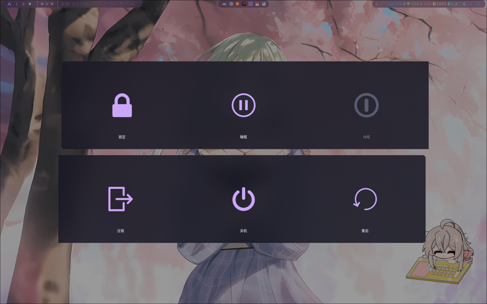

# sakinux

> 练手向配置，不是发行版。壁纸、锁屏、私有工具链不在仓库里 —— 见 [未收录清单](docs/not-included.md)。


极简的 Hyprland 桌面：没有 dock、没有桌面图标，屏幕上只有一条 30px 的浮岛顶栏，剩下的全靠键盘。

- **全键盘**：启动、切窗口、平铺、截图、关机全部有键位，鼠标只用来点链接
- **一条栏**：waybar 拆成左/中/右三块浮岛，缝隙透出壁纸；毛玻璃只开给 waybar、rofi、wlogout 三个浮层
- **一个调色板**：26 个色槽，一处改色，顶栏 / 关机菜单 / 终端 / GTK / 图标 / 光标 / 输入法全跟着变
- **两套自制主题**：Morandi Canvas（CIELAB 规则生成 + WCAG 对比度回测）、Nordic Fjord（214° 冷蓝灰）
- **自己写的工具**：GTK4 Wi-Fi 菜单（763 行，密码走 DBus）、6 个 waybar 模块、Papirus 变色变体生成器

## Preview

| 桌面 | fastfetch |
|:---:|:---:|
| [](screenshots/desktop.png) | [](screenshots/fastfetch.png) |
| **wlogout**（`Super+Delete`） | **waybar** |
| [](screenshots/wlogout.png) | [](screenshots/waybar.png) |

<details>
    <summary>更多截图</summary>

| 启动器（`Super+R`） | GTK 主题 / Nemo |
|:---:|:---:|
| [](screenshots/launcher.png) | [](screenshots/gtk.png) |

</details>

> [!TIP]
> 图还没放。按上面的文件名丢进 `screenshots/` 就自动显示，拍法见 [screenshots/README.md](screenshots/README.md)。

> [!NOTE]
> 这套配置假定 1920×1200 的屏幕、Intel 核显、`BAT0` 电池。换机器要改的几处都列在 [已知问题](docs/install.md#已知问题)。

## 安装

<details>
    <summary>自动</summary>

```bash
git clone <this-repo> ~/dotfiles && cd ~/dotfiles
./install.sh --dry-run     # 先看会做什么
./install.sh               # 已存在的文件先备份到 ~/.dotfiles-backup-<时间戳>/
systemctl --user enable --now cliphist
```

装完注销重登。依赖清单和一次性步骤：[docs/install.md](docs/install.md)

</details>

<details>
    <summary>手动</summary>

- 依赖：`hyprland waybar wlogout rofi swaync ghostty starship fastfetch cliphist` + `ttf-jetbrains-mono-nerd`
- 外观：`catppuccin-gtk-theme-mocha` `catppuccin-cursors-mocha` `papirus-icon-theme`
- 配置：`config/` → `~/.config/`，`local/` → `~/.local/`，`gtk-themes/` → `~/.themes/`
- 把 `config/wlogout/style.css`、`config/fastfetch/config.jsonc`、`config/autostart/bongocat.desktop` 里的 `@@HOME@@` 换成你的家目录
- 图标变色：`python3 theme-studio/icon-variants.py build`

</details>

## 键位

| 键 | 动作 | 键 | 动作 |
|---|---|---|---|
| `Super+Q` | 终端 | `Super+R` | 启动器 |
| `Super+C` | 关窗 | `Super+E` | 文件管理器 |
| `Super+V` | 浮动切换 | `Super+J` | 切分屏方向 |
| `Super+方向键` | 移焦点 | `Super+1..0` | 切工作区 |
| `Super+Alt+X` | 区域截图 | `Super+Delete` | wlogout |

完整表：[docs/keybinds.md](docs/keybinds.md)

## 文档

- [安装与依赖、已知问题](docs/install.md)
- [完整键位](docs/keybinds.md)
- [主题系统：26 槽引擎 + 6 个生成器](docs/theme-studio.md)
- [设计取舍与代价](docs/design.md)
- [未收录的部分：归属 + 自己怎么做](docs/not-included.md)

## Thanks to

- [HyDE](https://github.com/HyDE-Project/HyDE)：wlogout 的观感移植自它的 `style_1`
- [Catppuccin](https://github.com/catppuccin)：26 槽色值、GTK 主题基座、光标、fcitx5 皮肤、ghostty 配色
- [Papirus](https://github.com/PapirusDevelopmentTeam/papirus-icon-theme) + papirus-folders：图标基座
- [BongoCat](https://github.com/ayangweb/BongoCat)：桌宠
- [waywallen](https://github.com/waywallen/waywallen)：动态壁纸客户端
- [Hyprland](https://github.com/hyprwm/Hyprland)：配置骨架来自它自带的 Lua 模板
- wlogout 图标来自 onlinewebfonts.com 的 Svg Vector Icons

## License

MIT（自有部分）。上游资源的授权见 [docs/not-included.md](docs/not-included.md) 各节。随便抄。
